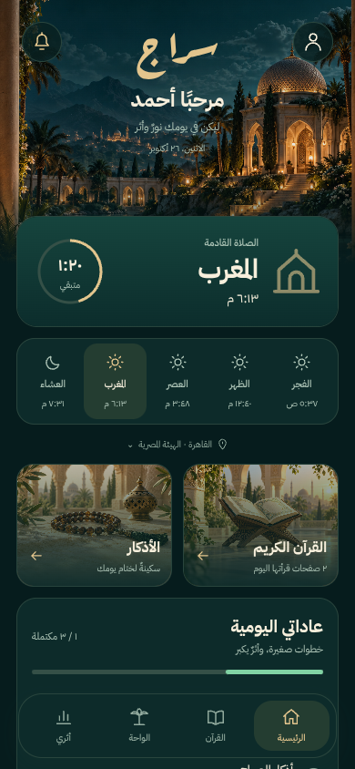
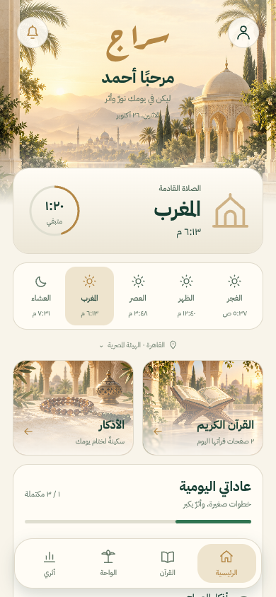
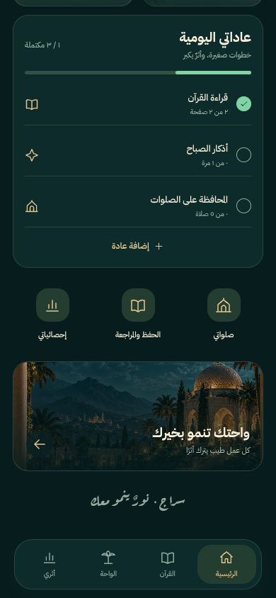
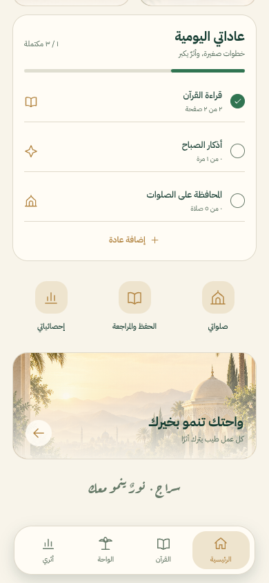

# The real Siraj homepage

These screenshots were captured from the running app at a 390 × 844 phone viewport. The name and habit records are sample data in an isolated browser test; no demo profiles were sent to Firebase. Prayer information is calculated by the app. Exact typography and safe-area spacing can vary slightly on a physical iPhone.

## Night and dawn

| Immersive Night | Luminous Dawn |
| --- | --- |
|  |  |

## Scroll down: habits, quick actions and oasis

| Night details | Dawn details |
| --- | --- |
|  |  |

## Try it

All artwork is bundled in `assets/design`. No files need to be copied from another project.

1. Download and extract the latest repository ZIP.
2. Open Terminal inside **sirag 29 updated**.
3. Run `npm ci`, then `npx expo start --clear`.
4. Open the project using Expo Go for SDK 58, or press `w` for the browser version.
5. Tap the person icon at the top right. Select **ليلي** (dark), **نهاري** (light), or **حسب الجهاز** (follow device). The choice is saved.

## Working controls

- The next-prayer card uses the chosen city, calculation method and real clock; its ring reflects the current prayer interval.
- Tap a prayer marker or the prayer card to open Salah tracking.
- Tap the city line to search cities, change the calculation method, or request device location.
- Quran and Athkar cards open their existing screens and show saved reading/session progress.
- Daily habit rows open the appropriate tracker. Custom habits have an entry sheet supporting addition and correction of the day's total, including Arabic numerals.
- The bell opens prayer reminders. The profile menu also opens profile editing.
- The dock opens Home, Quran, Oasis and Reports. Additional shortcuts open prayer tracking, Hifz and detailed reports.
- Pull down to refresh saved activity. Empty states invite the user to choose a habit; production screens do not invent completed activity.

This release redesigns the homepage and adds shared appearance preferences. Existing worship storage keys and data are preserved. Firebase activation and custom adhan device-build requirements remain described in [the setup notes](../FIREBASE-AND-NOTIFICATIONS.md).

## Validation

### iPhone startup correction

If Expo Go reports `Component auth has not been registered yet`, use the updated download containing `metro.config.js`. It makes Firebase 9's native Auth and app entry points share one registry. After installing dependencies, restart with `npx expo start --clear` and scan the new QR code. The corrected iOS and Android export source maps were checked for exactly one Firebase app registry and the native Auth entry.

- TypeScript and all 54 existing unit/regression tests pass.
- Full iOS, Android and web exports pass.
- Browser checks cover both modes, persistent settings after reload, live system-theme changes, Arabic-number habit additions/corrections, city selection, Quran/report navigation, and 320/375/768-pixel layouts.
- Physical-device appearance, audio and notification delivery still need testing on the phone.
