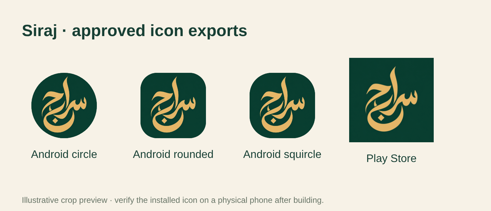

# Approved calligraphic icon and closed testing

The uploaded `download.png.zip` contains the owner's selected **سراج** gold-on-emerald calligraphy. Its original 1254 × 1254 PNG is preserved byte-for-byte as `assets/store/icon-master.png`. The lettering was not regenerated or redrawn.

Exports generated by `npm run build:icons`:

| Purpose | File |
| --- | --- |
| Installed app icon (1024 × 1024) | `assets/store/icon.png` |
| Android adaptive foreground (1024 × 1024) | `assets/store/adaptive-foreground.png` |
| Google Play listing icon (512 × 512) | `store-listing/icon-512.png` |


The adaptive export preserves the complete original colour image and pads it on a transparent 1024px canvas; the emerald field covers the normal launcher mask. A 74% source scale keeps the gold lettering, tall alif and jim dot inside Android's guaranteed central safe circle. The adaptive background is emerald `#0C3D31`. Existing splash/header lettering and the Play feature graphic are unchanged.



## Build the new version

Version **8** has the previous icon. It cannot be edited after compilation. Download the updated project ZIP and open Terminal in its **sirag 29 updated** folder:

```sh
npm ci
npx eas-cli build --platform android --profile play-closed
```

`play-closed` inherits the existing `play-internal` store/AAB profile, remote automatic version-code increment and **test ads**. It keeps the same package `com.sirag.livingdesert`, Expo project and signing credentials. If 8 remains the latest remote version code, the next build should be 9; EAS's actual result is authoritative. The profile name does not upload or select a Play track automatically.

## Release in Play Console

1. Download the completed AAB from EAS.
2. Open **Testing → Closed testing**, choose/create the closed-test track and create a release.
3. Upload the new AAB, complete any outstanding store/content tasks, and review the release.
4. Under **Grow users → Store presence → Main store listing**, upload `store-listing/icon-512.png` as the app icon and save. Store artwork is separate from the AAB's launcher icon; Google may review metadata changes.
5. Add the tester email list or Google Group to this **closed** track, configure countries/regions as needed and roll out for closed testing.
6. Share the track's opt-in link. Testers must accept using the same Google account active in Play Store. Internal-test membership alone does not enroll them in the closed test.
7. Follow the exact tester count and consecutive duration shown on the app Dashboard, then apply for production access. Public production access is still locked in the owner's supplied screenshot. No same-day public release is promised.

Arabic release notes:

> تحديث هوية سراج بأيقونة عربية جديدة، وإضافة أصوات مخصصة للأذان والوضوء وتذكير الصلاة، وتحسين التنقل داخل الواحة.

## Verification and limits

Original-file checksum, PNG sizes/opacity, adaptive gold-stroke bounds, resolved Expo config, package identity and inherited closed-test build settings were checked. Local release-package checks pass. The crop preview is illustrative, not a physical launcher test; verify the installed icon on a phone after building. No signed AAB was created and no Play upload or rollout was performed from this workspace. Google review and production eligibility remain external requirements.
