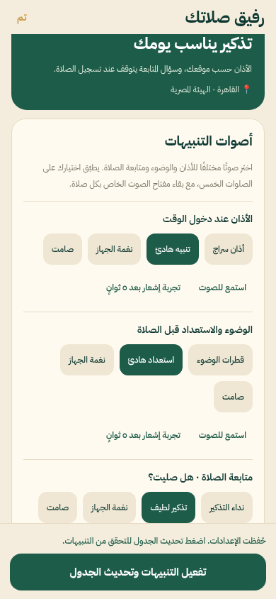

# Prayer, wudu and follow-up sounds

Open **Home → prayer bell → رفيق صلاتك → أصوات التنبيهات**.

| Notification | Default | Choices |
| --- | --- | --- |
| At the prayer time | أذان سراج | Adhan recording, gentle cue, device sound, silent |
| Before prayer: wudu/preparation | قطرات الوضوء | Water cue, soft preparation cue, device sound, silent |
| After prayer: هل صليت؟ | نداء التذكير | Bell cue, gentle follow-up cue, device sound, silent |

Selections persist independently, apply to all five prayers and leave the existing timing, reminder intensity and enabled flags unchanged. Each prayer's existing sound switch can still mute its adhan. Wudu reminders must have a nonzero “before” interval and follow-up reminders must be enabled to be scheduled. Saving a sound does not enable either automatically. Checking in and female exemption days still suppress the applicable follow-ups.

Each category includes **استمع للصوت** with a stop control, and **تجربة إشعار بعد ٥ ثوانٍ**. The latter schedules a local sample notification using the selected native channel; it does not log worship or send messages to another person. Preview playback stops when leaving the screen. Device/default and silent choices cannot be auditioned as bundled audio; use the native sample notification for the device tone.

Android sounds use a stable category-and-sound-specific channel ID because an existing channel's sound cannot be changed programmatically. Existing OS user channel overrides remain respected. Changing the choice reschedules affected requests without changing prayer times. The app does not bypass notification volume, Do Not Disturb or OS permission restrictions.

The background notification adhan is the existing **29.5-second recording**, which fits the iOS under-30-second notification sound limit. The full recording plays while Siraj is active and the adhan recording is selected. Foreground OS playback is suppressed for this case so it does not overlap the full recording. Selecting another sound suppresses full-recording playback instead. Silent choices suppress both paths.

Five original non-vocal PCM cues are bundled (1.3–2.04 seconds), generated reproducibly by `scripts/build-notification-tones.py`. Their source is original mathematical synthesis, with no third-party recording. The existing adhan source and CC0 dedication remain documented in `assets/sounds/ATHAN_LICENSE.md`.

## Native testing and release

A **new native build is required** because custom notification sound assets are bundled by the expo-notifications config plugin. Expo Go/web can preview the audio and save choices, but do not provide a reliable test of bundled OS notification sounds. Use the new Android internal build to test all three categories with the app open and with the screen locked. iOS requires a native development/TestFlight build for system sound testing; Expo Go is only the in-app preview.

TypeScript, the test suite, all-platform JavaScript exports and browser settings/audio-preview flows are checked. Tests cover independent default sounds, mute behavior, unchanged timing, request reconciliation, category validation, foreground overlap suppression and WAV registration/format/duration. Native notification delivery and actual volume must still be checked on a physical phone. No paid backend or remote push service is required or enabled.
