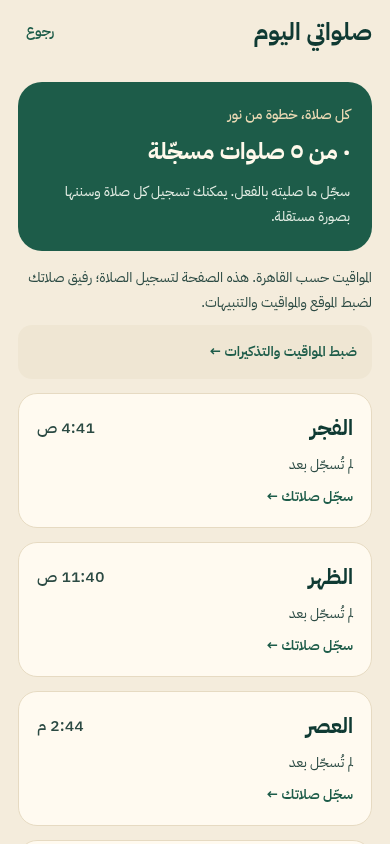
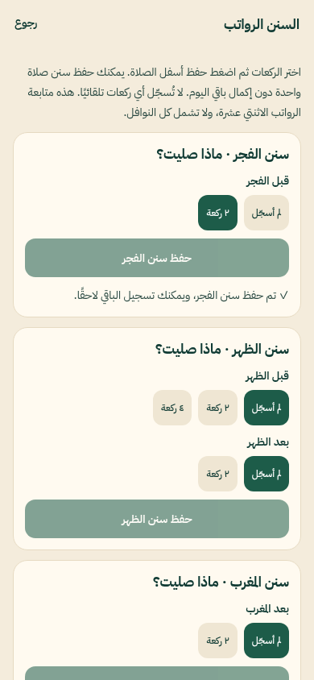
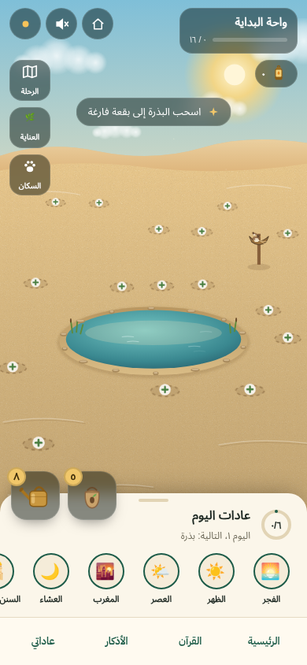
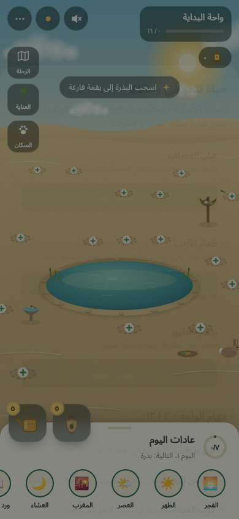

# Daily tracking and oasis care update

This update makes the homepage tour lighter, adds explicit Sunnah submission, makes habits removable and expands the living oasis.

## Changes

- Tour scrim opacity reduced from 82% to 48%, keeping the actual background visible.
- Each Sunnah prayer card has its own **حفظ سنن…** button, pending selections and saved confirmation. Saving one prayer does not require the others to be completed or mark a fard prayer as done. Updates merge only that prayer's Sunnah slots, preserving other records.
- **إضافة أو إدارة العادات** opens the library with a **عاداتي الحالية** section. Removing a plan asks for confirmation, removes that plan and its future plan reminders, and preserves historical logs. Independent prayer reminder preferences remain under **رفيق صلاتك**.
- **صلواتي اليوم** is now a compact Arabic recording screen, including on English-language devices. It shows all five prayer times and check-in status, opens the same check-in flow and Sunnah tracker, preserves the weekly timetable in an expandable section, and links to **رفيق صلاتك** for location, calculation and reminder preferences. Female-only exemption controls remain conditional on the profile.
- Two Athkar banner positions remain after cards **4 and 10**. Expo Go and web show explicitly labelled layout placeholders, with no ad revenue. Native internal builds request Google test banners; production retains the supplied Android banner ID. Smaller 320px phones are no longer excluded solely by the old 348px threshold. Live no-fill/consent/network failures still hide the banner. Real ad delivery cannot be guaranteed. iOS live AdMob IDs remain unset.
- A persistent oasis navigation bar offers **الرئيسية، القرآن، الأذكار، عاداتي**.
- Planting spots alternate between the water's edge, middle ground and outer sand. Saved plot indices, planted species and growth stages remain intact; their scene positions change to the new spread.
- Four original procedural tree species added: **السنط، الليمون، اللوز المزهر، المورينجا**. The first oasis now offers eight plant choices, including four trees. Later locations retain more plants to discover.
- **العناية** opens **12 garden quests** plus three care actions. A nest costs two water drops and brings birds; a bird bath costs two drops and attracts a visiting bird; rabbit food costs one drop and shows a rabbit approaching and chewing. Nest/bath construction persists. Food can be replenished once per local calendar day. Insufficient resources and repeat construction are blocked. Care consumes garden resources and does not record worship or issue spiritual rewards. Reduced-motion users see residents without the approach animation.
- Removed rectangular pointer-focus outlines around plants, retaining a subtle ellipse for keyboard focus.

## Previews

| Prayer recording | Independent Sunnah save |
| --- | --- |
|  |  |

| Athkar preview placement | Oasis navigation and care |
| --- | --- |
|  |  |

## Verification

TypeScript and all-platform JavaScript exports pass. The existing suite passes 104 tests with one emulator-dependent test skipped. Browser flows verify independent Sunnah submission without other prayer records, plan removal with retained history, both Athkar positions, the complete onboarding tour, habitat resource costs/repeat protection/persistence, tree choices, scattered geometry and animal residents. Browser tests block cloud requests and use fixture data. Screenshots are web previews; native ad loading and final Android/iOS layout require a signed build and device check.

No paid service was enabled, no native AAB was built here, and no Play release was submitted. Use the complete project ZIP, run `npm ci`, then `npx eas-cli build --platform android --profile play-internal` for the next internal release with existing credentials and automatic version-code increment.
