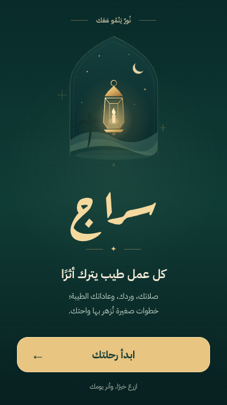
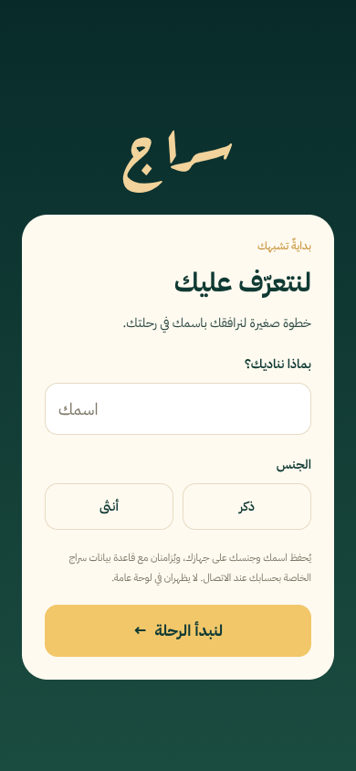
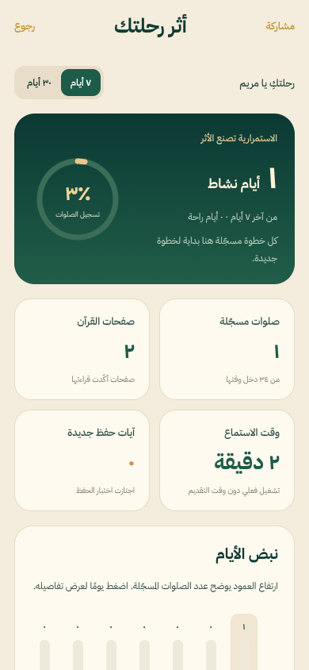
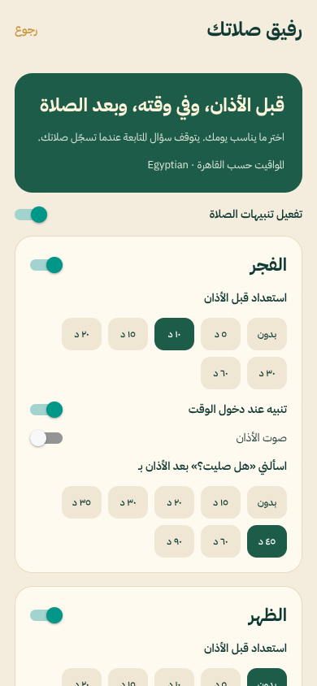

# Updated Sirag screens

Captured during browser checks at phone-sized viewports. The report uses sample data inserted only in an isolated browser test. Firebase requests were blocked during these checks; these screenshots do not show live cloud records. Native-device appearance and sound still require device testing.

## Arabic splash

## Personal profile

## Detailed reports

## Prayer reminder settings

