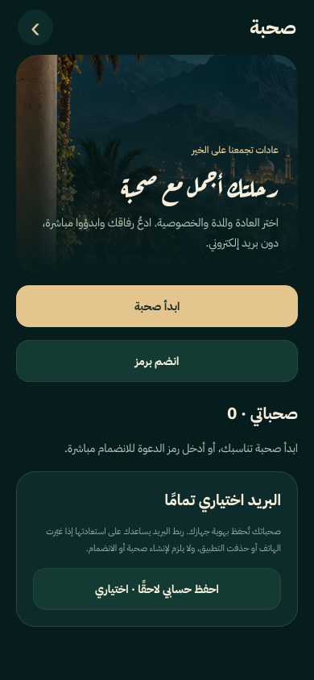
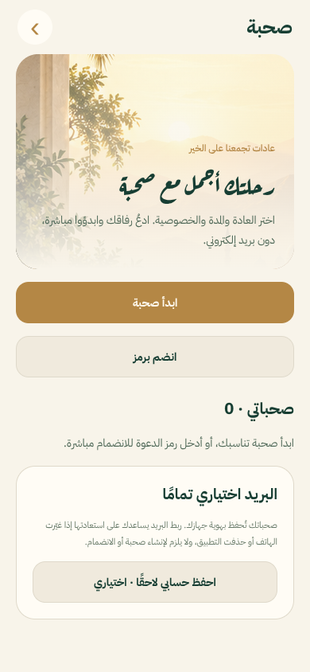
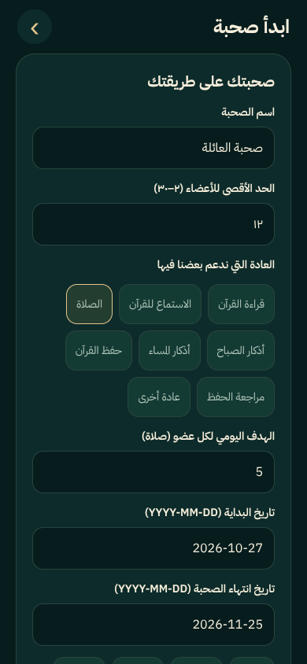
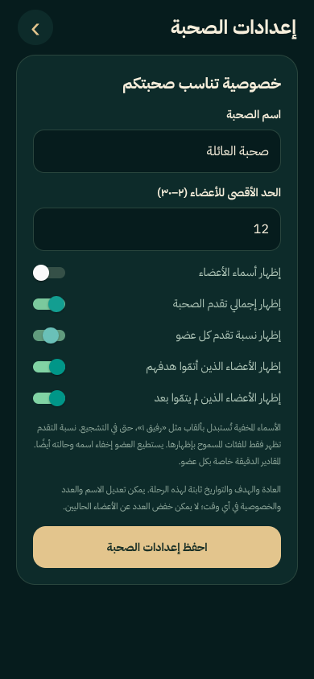
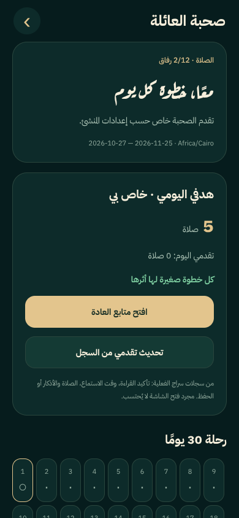
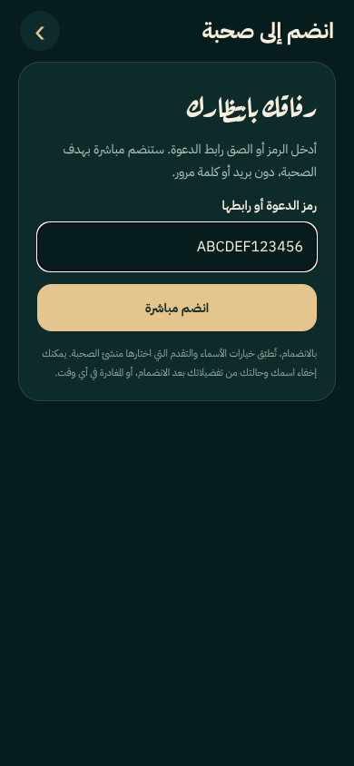
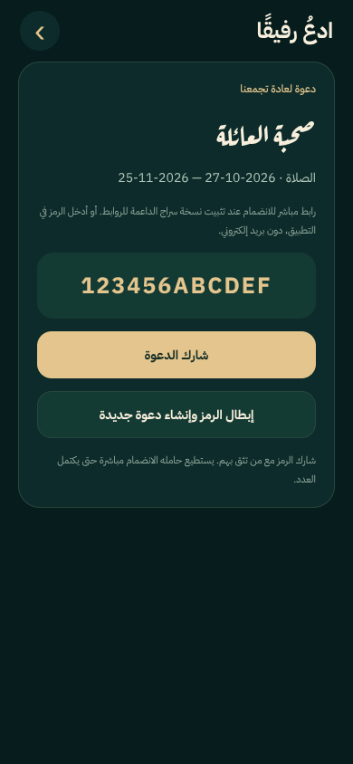

# صحبة · no-email creation and joining

Browser captures of the implemented React Native screens at a phone viewport. They use an injected test service and sample data, **not a deployed Firebase database**. Real native appearance, notifications and OS link verification still need phone testing.

| Night | Dawn |
| --- | --- |
|  |  |

| Create: capacity, habit, goal and end date | Creator's independent privacy controls |
| --- | --- |
|  |  |

| Circle with aggregate progress hidden | Join using only a code |
| --- | --- |
|  |  |

Creators choose 2–30 members, 1–90 days, a habit and target, name visibility, aggregate/individual progress and whether to show completed or pending members. Invitation routes join automatically; code entry needs one button. Email linking is an optional recovery action.

[Firebase activation, native links, privacy and validation](SOHBA.md).
