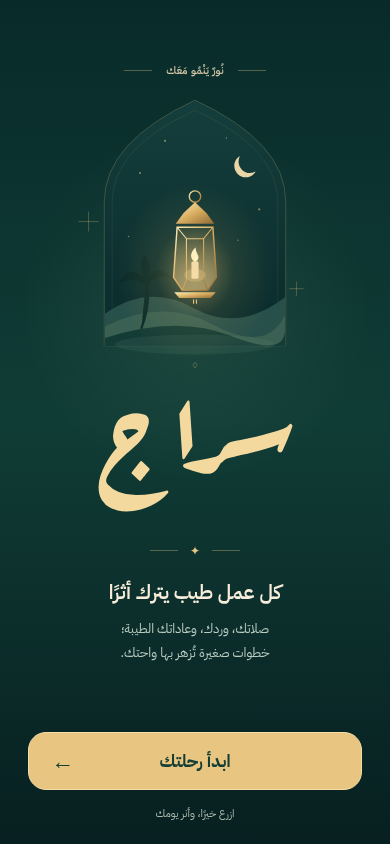
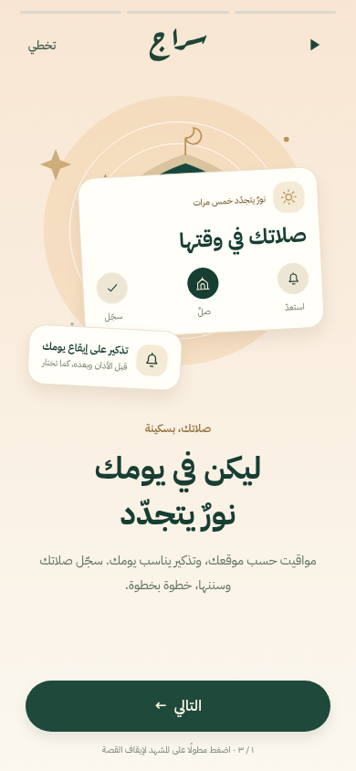
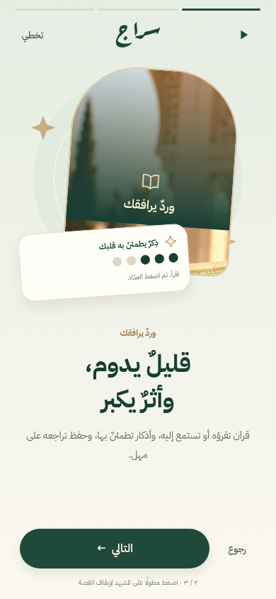
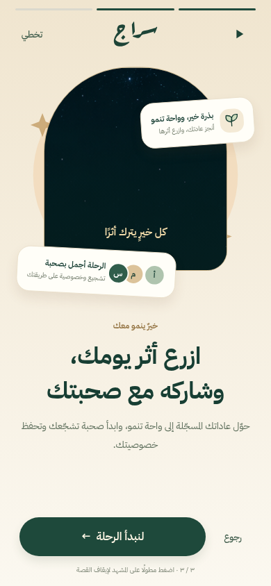
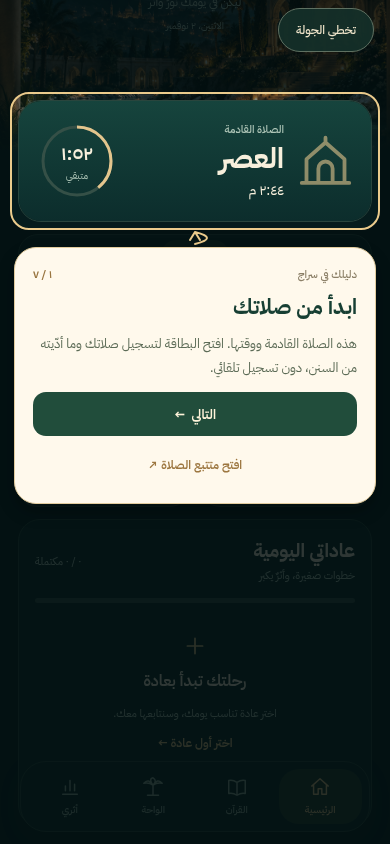
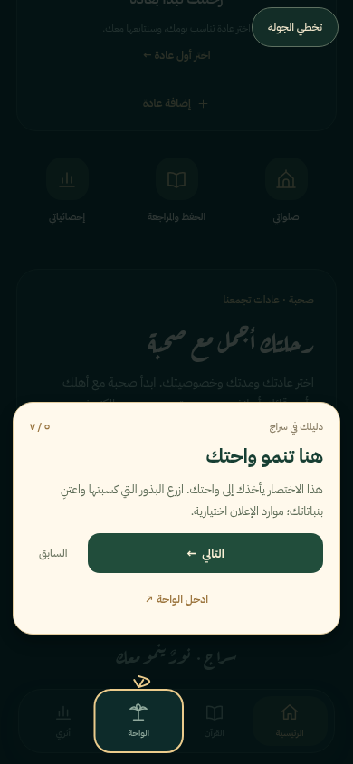

# Stories and first-visit homepage tour

The startup experience now has two separate stages: three visual stories introduce Siraj, then a tour highlights the real homepage controls after profile setup. Existing profiles are retained.

## Preview

| Splash | Prayer story | Daily reading story |
| --- | --- | --- |
|  |  |  |

| Your oasis | Homepage spotlight | Oasis shortcut |
| --- | --- | --- |
|  |  |  |

The screenshots show the actual web build at 390 × 844. Native safe areas, font scaling, screen readers and Android/iOS rendering still need a device check in the next signed build.

## Behavior

- Stories use progress segments, original illustrations, next/back controls, tap zones, hold-to-pause and an explicit pause/resume button. Backgrounding pauses progression. Reduced-motion and screen-reader users start with automatic progression paused. The final story waits for the user to start.
- New users see stories, profile setup, then the homepage. The homepage tour measures actual controls, scrolls them into view and uses a dimmed mask, gold highlight and arrow. It covers prayers, reminders, daily reading, habits, the oasis, reports and circles.
- Highlighted items and “try” actions open the corresponding real section. Returning continues the tour. No worship activity or completion is recorded by the illustrations or tour.
- Both stages can be skipped. Both can be replayed from the homepage profile/appearance menu. Separate versioned local completion keys (`siraj-onboarding-stories-v2` and `siraj-home-coachmarks-v2`) prevent repeated automatic presentation. Older users see the new introduction once without losing their data. A notification launch does not interrupt the user with an automatic homepage tour.
- The Arabic wordmark is shaped from the bundled Aref Ruqaa Bold font and rendered as vector outlines, with the full glyph bounds including the ج descender. This removes reliance on platform text line-box clipping. The source font license is `assets/fonts/AREFRUQAA-OFL.txt`; the optional regeneration script is `scripts/build-wordmark.py` (fontTools and uharfbuzz required only for regeneration).

## Validation and release

TypeScript, unit tests and Android/iOS/web JavaScript exports were checked. Browser automation exercised the three stories, profile setup, every homepage tour step, real section navigation and return, skip, completion and replay without JavaScript exceptions or fabricated Athkar progress. Cloud requests were blocked during browser testing.

The supplied Insider demo URL returned HTTP 403 in this environment; the attached visual references informed the story layout. No native build or Play submission was performed here. Download the complete source ZIP and run the existing `play-internal` EAS build workflow with the current signing credentials; EAS remote version-code increment must stay enabled.
